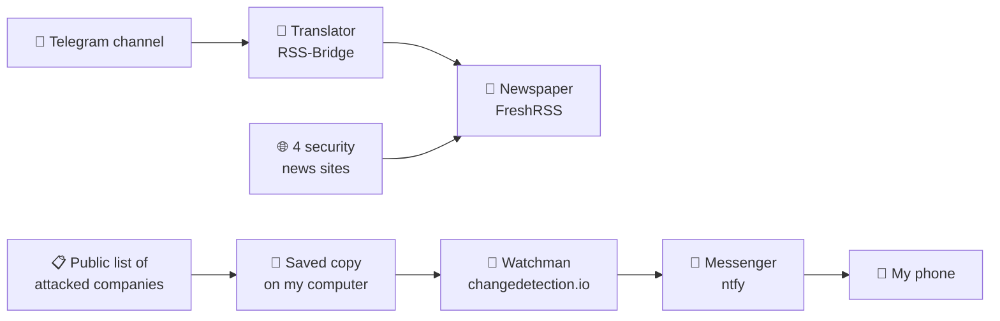

# 🛰️ Lab 05: My First Automatic Monitoring System

🌐 [Español](README.md) · **English**

---

## What did I do, in one sentence?

I built a **system on my computer that reads security news for me and sends an alert to my phone** when something new and important shows up.

## The problem

Imagine your job is to find out, as soon as possible, when a company in Costa Rica suffers a cyberattack. To do that, you would have to:

- check many websites and news channels every day,
- read everything, even though most of it is not important,
- and you might still find out too late.

Doing this by hand is slow, boring and easy to forget.

## The solution, explained with a comparison

Think of this system as hiring **a few helpers**:

| Helper | What it does | Real-life comparison |
|---|---|---|
| **The translator** (RSS-Bridge) | Takes a Telegram channel and turns it into a format other programs understand. | Someone who rewrites another person's notes neatly so everyone can read them. |
| **The newspaper** (FreshRSS) | Gathers news from 5 different sources onto one screen. | A newspaper that brings stories from several papers together in one place. |
| **The watchman** (changedetection.io) | Checks a page every so often and notices if something changed. | A guard who looks at the same door every 15 minutes and speaks up if anything is different. |
| **The messenger** (ntfy) | Sends the alert to my phone. | Someone who knocks on your door with an urgent message. |

All these helpers live inside my computer, in **separate "little boxes"** called *containers* (Docker). Each box holds its own program, so they don't mix or get in each other's way.

## How it works

There are **two paths**:

1. **For reading:** the news arrives on its own, all together and organized on one screen.
2. **For alerting:** if a new Costa Rican company appears on the list of attacks, I get an alert on my phone.

## What I did, step by step

1. **I prepared the computer.** I checked the internet connection and installed Docker, the program that creates the "little boxes".
2. **I started the 4 programs** with a single instruction file.
3. **I connected a security news channel** on Telegram and turned it into a readable format.
4. **I built my "newspaper"** with 5 sources in two sections: *Underground* (Telegram) and *Intelligence* (news sites). In a few minutes it gathered **75 articles**.
5. **I saved a copy of the attack list** and set the computer to update it automatically every 15 minutes. That way I don't ask the original source too often, since it has a limit.
6. **I set up the watchman** to look **only at company names**, not everything else. This avoids useless alerts.
7. **I ran a test:** I made up a fake victim ("Empresa Ficticia S.A.") and confirmed the alert reached my phone.

## Proof that it works

| What you see | Screenshot |
|---|---|
| The Telegram channel turned into a readable format | `capturas/06-rssbridge-feed-html.png` |
| The 5 organized sources | `capturas/09-freshrss-fuentes.png` |
| The "newspaper" with 75 articles | `capturas/10-freshrss-tablero.png` |
| The watchman marking what changed (red = before, green = now) | `capturas/13-prueba-diff.png` |
| The alert that reached my phone | `capturas/14-alerta-celular.png` |

> I covered the name of my alert channel in the screenshots, for security.

## Problems I ran into and how I solved them

Not everything worked the first time, and that is part of learning too:

| Problem | Simple explanation | Solution |
|---|---|---|
| The terminal said "permission denied". | The computer didn't yet know I had permission to use Docker in a new window. | I logged out and back in so it recognized the permission. |
| The watchman refused to check my test page. | For safety, the program blocks internal addresses so nobody can use it to spy on private networks. The guide didn't mention this. | I gave it explicit permission, only inside this lab. |
| The filter to read only the names gave an error. | The program didn't understand the way I wrote the instruction. | I used another way of writing it that it did understand (`jq:.[].post_title`). |
| Alerts arrived full of strange symbols. | They came in web page format, but the phone showed them as plain text. | I switched the format to plain text and wrote my own message. |
| My alert channel had an easy-to-guess name. | These channels are public: anyone who guesses the name can read your alerts. | I changed it to a long, random name. |
| The first alert was a huge file. | The first time, every company on the list looked "new". | I turned on the option to alert **only** when something never seen before appears. |

## What I learned

- **Automating is not about collecting more, but collecting better.** Getting 75 articles is useless if you can't read them; the value is in filtering.
- **"Noise" is the enemy.** If the system alerts you about everything, you end up ignoring the alerts, even the important ones.
- **Sources must be protected.** If everyone asks the same source at the same time, it gets overloaded or blocks you. That's why I saved a copy and only ask every 15 minutes.
- **Some sources are fragile.** A Telegram channel could disappear tomorrow, so it's best not to depend on a single source.
- **Security is in the details.** An easy-to-guess name or a password published by mistake can ruin all the work.

## Privacy precautions

- I did not publish my passwords or the name of my alert channel.
- I did not publish the list of attacked companies: it is sensitive information about real victims.
- All the information used comes from **public sources**.

## Mini dictionary

| Word | Simple meaning |
|---|---|
| **Feed / RSS** | A list of updates from a website that other programs can read automatically. |
| **Docker / container** | A "little box" where a program lives with everything it needs, separate from the others. |
| **Ransomware** | An attack where criminals lock or steal a company's data and demand money. |
| **API** | A "service window" through which one program asks another for information. |
| **Filter** | A rule that only lets important things through. |
| **OSINT** | Investigating using only public information. |
