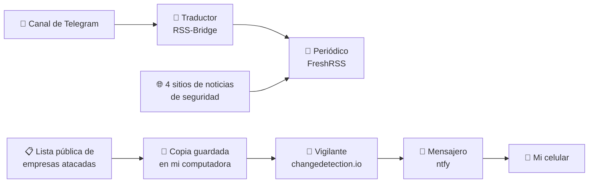

# 🛰️ Lab 05: Mi primer sistema de vigilancia automática

🌐 **Español** · [English](README.en.md)

---

## ¿Qué hice, en una frase?

Construí en mi computadora un **sistema que lee noticias de seguridad por mí y me manda un aviso al celular** cuando aparece algo nuevo e importante.

## El problema

Imagina que tu trabajo es enterarte, lo antes posible, cuando una empresa de Costa Rica sufre un ataque informático. Para lograrlo tendrías que:

- revisar muchas páginas web y canales de noticias todos los días,
- leer todo, aunque la mayoría no sea importante,
- y aun así podrías enterarte tarde.

Hacer eso a mano es lento, aburrido y fácil de olvidar.

## La solución, explicada con una comparación

Piensa en este sistema como si contrataras a **tres ayudantes**:

| Ayudante | Qué hace | Comparación de la vida real |
|---|---|---|
| **El traductor** (RSS-Bridge) | Toma un canal de Telegram y lo convierte a un formato que otros programas entienden. | Alguien que pasa a limpio las notas de otra persona para que todos las puedan leer. |
| **El periódico** (FreshRSS) | Junta noticias de 5 fuentes distintas en una sola pantalla. | Un periódico que trae en un solo lugar las noticias de varios diarios. |
| **El vigilante** (changedetection.io) | Revisa una página cada cierto tiempo y nota si algo cambió. | Un guardia que mira la misma puerta cada 15 minutos y avisa si algo es diferente. |
| **El mensajero** (ntfy) | Envía el aviso al celular. | Alguien que te toca la puerta para darte un recado urgente. |

Todos estos ayudantes viven dentro de mi computadora, en **"cajitas" separadas** llamadas *contenedores* (Docker). Cada cajita tiene su propio programa, y así no se mezclan ni se estorban.

## Cómo funciona

Hay **dos caminos**:

1. **Para leer:** las noticias llegan solas a una pantalla, todas juntas y ordenadas.
2. **Para alertar:** si aparece una empresa nueva de Costa Rica en la lista de ataques, me llega un aviso al celular.

## Lo que hice, paso a paso

1. **Preparé la computadora.** Revisé que tuviera internet e instalé Docker, el programa que crea las "cajitas".
2. **Encendí los 4 programas** con un solo archivo de instrucciones.
3. **Conecté un canal de Telegram** de noticias de seguridad y lo convertí en un formato legible.
4. **Armé mi "periódico"** con 5 fuentes en dos secciones: *Underground* (Telegram) e *Inteligencia* (sitios de noticias). En pocos minutos juntó **75 artículos**.
5. **Guardé una copia de la lista de ataques** y programé la computadora para actualizarla sola cada 15 minutos. Así no le pregunto demasiadas veces a la fuente original, que tiene un límite.
6. **Configuré el vigilante** para que mire **solo los nombres de las empresas** y no todo lo demás. Esto evita avisos inútiles.
7. **Hice una prueba:** inventé una víctima falsa ("Empresa Ficticia S.A.") y comprobé que el aviso llegó al celular.

## Las pruebas de que funciona

| Qué se ve | Captura |
|---|---|
| El canal de Telegram convertido a formato legible | `capturas/06-rssbridge-feed-html.png` |
| Las 5 fuentes organizadas | `capturas/09-freshrss-fuentes.png` |
| El "periódico" con 75 artículos | `capturas/10-freshrss-tablero.png` |
| El vigilante marcando lo que cambió (rojo = antes, verde = ahora) | `capturas/13-prueba-diff.png` |
| El aviso que llegó al celular | `capturas/14-alerta-celular.png` |

> En las capturas tapé el nombre de mi canal de avisos, por seguridad.

## Problemas que encontré y cómo los resolví

No todo salió a la primera, y eso también es parte del aprendizaje:

| Problema | Explicación sencilla | Solución |
|---|---|---|
| La terminal decía "permiso denegado". | La computadora no sabía todavía que yo tenía permiso para usar Docker en una ventana nueva. | Cerré sesión y volví a entrar para que reconociera el permiso. |
| El vigilante se negaba a revisar mi página de prueba. | Por seguridad, el programa bloquea las direcciones internas para que nadie lo use para espiar redes privadas. La guía no lo mencionaba. | Le di permiso explícito, solo dentro de este laboratorio. |
| El filtro para leer solo los nombres daba error. | El programa no entendía la forma en que escribí la instrucción. | Usé otra forma de escribirla que sí entendía (`jq:.[].post_title`). |
| Los avisos llegaban llenos de símbolos raros. | Venían en formato de página web, pero el celular los mostraba como texto. | Cambié el formato a texto simple y escribí mi propio mensaje. |
| Mi canal de avisos tenía un nombre fácil de adivinar. | Esos canales son públicos: cualquiera que adivine el nombre puede leer tus avisos. | Lo cambié por un nombre largo y aleatorio. |
| El primer aviso fue un archivo enorme. | La primera vez, todas las empresas de la lista parecían "nuevas". | Activé la opción de avisar **solo** cuando aparece algo que nunca se ha visto. |

## Lo que aprendí

- **Automatizar no es juntar más información, sino juntar mejor.** Recibir 75 artículos no sirve de nada si no puedes leerlos; lo valioso es filtrar.
- **El "ruido" es el enemigo.** Si el sistema avisa por cualquier cosa, terminas ignorando los avisos, incluso los importantes.
- **Hay que cuidar las fuentes.** Si todos le preguntan a la misma fuente al mismo tiempo, esta se satura o te bloquea. Por eso guardé una copia y pregunto solo cada 15 minutos.
- **Algunas fuentes son frágiles.** Un canal de Telegram puede desaparecer mañana, así que no conviene depender de una sola fuente.
- **La seguridad está en los detalles.** Un nombre fácil de adivinar o una contraseña publicada por error pueden echar a perder todo el trabajo.

## Cuidados de privacidad

- No publiqué mis contraseñas ni el nombre de mi canal de avisos.
- No publiqué la lista de empresas atacadas: es información sensible sobre víctimas reales.
- Toda la información usada proviene de **fuentes públicas**.

## Mini diccionario

| Palabra | Significado sencillo |
|---|---|
| **Feed / RSS** | Una lista de novedades de una página web que otros programas pueden leer automáticamente. |
| **Docker / contenedor** | Una "cajita" donde vive un programa con todo lo que necesita, separado de los demás. |
| **Ransomware** | Un ataque en el que los delincuentes bloquean o roban los datos de una empresa y piden dinero. |
| **API** | Una "ventanilla" por la que un programa le pide información a otro. |
| **Filtro** | Una regla que deja pasar solo lo importante. |
| **OSINT** | Investigar usando solo información pública. |
